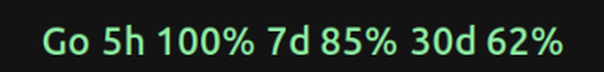
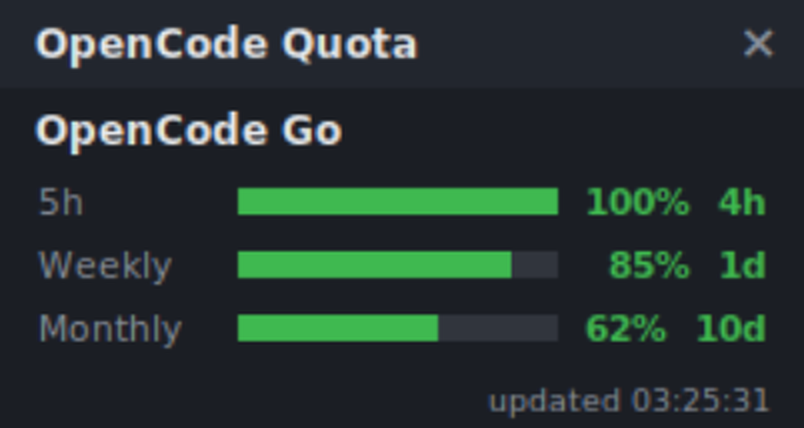

<p align="center">
  <a href="https://github.com/mingkun968/opencode-quota">
    <picture>
      <source srcset="opencode-quota-logo-dark.svg" media="(prefers-color-scheme: dark)">
      <source srcset="opencode-quota-logo-light.svg" media="(prefers-color-scheme: light)">
      
    </picture>
  </a>
</p>
<p align="center"><strong>在 GNOME 顶栏一行看住你的 AI 套餐额度</strong></p>

## 项目简介

本仓库 fork 自 [slkiser/opencode-quota](https://github.com/slkiser/opencode-quota)，在完整保留上游取数能力（25 种套餐、CLI、OpenCode 插件、TUI 界面）的基础上，新增了一个 **GNOME 顶部面板扩展**：把所有已配置套餐的剩余额度平铺在任务栏一行，30 秒实时刷新，只查询用量接口、不消耗 token。



## 功能

### GNOME 顶部面板（本仓库新增）

- **一行平铺全部套餐**：例如 `Go 5h 100% 7d 85% 30d 62%`；接入别的套餐后会自动接着排。
- **分段实时着色**：每个窗口按剩余比例独立上色（≥50% 绿、20–49% 黄、<20% 红），套餐名取其最紧张窗口的颜色。
- **实时刷新**：默认 30 秒，菜单可切 30 秒 / 1 分钟 / 5 分钟。
- **点击展开明细**：逐窗口的剩余百分比、重置倒计时，以及面板位置、刷新间隔、立即刷新。
- **位置可调**：左 / 中 / 右一键切换并记住（GNOME 状态区不支持鼠标拖动图标）。
- **失败不打断**：请求失败时保留上一次成功数据，错误显示在菜单底部。

### 桌面悬浮窗（可选）

不想占用顶栏时，可以开一个可拖动的置顶小窗，带彩色进度条与剩余百分比：



```bash
node dist/bin/opencode-quota.js widget   # 默认右上角，可拖动
```

位置、透明度、刷新间隔等参数见 [桌面悬浮窗](docs/readme/widget.md)。

### 上游能力（本仓库保留）

- **OpenCode 插件**：会话侧边栏配额面板、紧凑状态行、配额 toast、重置通知。
- **斜杠命令**：`/quota`、`/quota_status` 与 `/tokens_*` 系列 token 统计。
- **CLI**：`show`、`status`、`widget`、`init`、`update`、`provider add`。
- **集成**：JSON 输出、OpenTelemetry 指标、自定义 provider（任意 JSON 接口）。

## 安装

要求：Node.js ≥ 22；GNOME 面板需要 GNOME Shell 45–50（Wayland / X11）。

```bash
git clone https://github.com/mingkun968/opencode-quota
cd opencode-quota
corepack pnpm install
corepack pnpm run build

# 1) 安装 GNOME 面板扩展
corepack pnpm run install:gnome-extension
gnome-extensions enable opencode-quota@local

# 2) 把 CLI 放进 PATH（面板扩展靠它取数）
npm install -g .
opencode-quota show   # 验证能取到配额数据
```

> GNOME Shell 会缓存扩展模块：首次安装或修改过扩展代码后，必须**注销并重新登录**（Wayland）才会加载。
>
> 如果只想用上游的 OpenCode 插件 / TUI 功能，也可以直接 `npx @slkiser/opencode-quota@latest init`。

## 使用

### 面板

点击顶栏里的额度文字即可展开菜单：配额明细、`Panel position`（左/中/右）、`Refresh interval`（30 秒/1 分钟/5 分钟）、`Refresh now`。面板显示哪些套餐，取决于你在 OpenCode 里连接了哪些。

### 常用命令

OpenCode 内斜杠命令：

| 命令 | 用途 |
| --- | --- |
| `/quota` | 查看当前配额 |
| `/quota_status` | 诊断配置、认证、provider 与计价 |
| `/tokens_today` / `/tokens_daily` | 今日 / 近 24 小时 token 统计 |
| `/tokens_weekly` / `/tokens_monthly` / `/tokens_all` | 近 7 天 / 近 30 天 / 全部 token 统计 |
| `/tokens_session` / `/tokens_session_all` | 当前会话 / 含子会话的 token 统计 |
| `/tokens_between YYYY-MM-DD YYYY-MM-DD` | 指定日期区间的 token 统计 |
| `/pricing_refresh` | 刷新本地模型计价数据 |

终端 CLI：

| 命令 | 用途 |
| --- | --- |
| `opencode-quota show` | 快速查看配额 |
| `opencode-quota status` | 配置与 provider 诊断 |
| `opencode-quota widget` | 桌面悬浮窗（位置、透明度、刷新间隔等参数见文档） |
| `opencode-quota init` | 交互式安装与配置 |
| `opencode-quota provider add` | 添加自定义套餐 |
| `opencode-quota update` | 更新配置与缓存 |

完整参数用 `opencode-quota --help` 查看；JSON 输出的脚本 / CI 用法见[外部集成](docs/readme/external-integration.md)。

### 支持的套餐

| 套餐 | 凭据 / 设置 | 数据来源 | 面板显示 |
| --- | --- | --- | --- |
| OpenCode Go | 自动（复用 OpenCode 凭据） | 远程 API | 5h / 周 / 月 |
| OpenCode Zen | 需设置 | Dashboard 抓取 | 预算与余额 |
| OpenAI（ChatGPT Plus/Pro） | 自动 | 远程 API | 配额窗口 |
| Anthropic（Claude） | 需设置（Claude CLI/OAuth） | 本地 CLI/OAuth | 配额窗口 |
| GitHub Copilot | 自动 | 远程 API | 预算与用量 |
| Cursor | 需设置 | 本地估算 | 预算与消费 |
| xAI（SuperGrok / Lite / Heavy） | 自动 | 远程 API | 周配额 |
| Google Antigravity | 需设置 | 远程 API | 配额 |
| Google AGY | 需设置 | 远程 API | 配额 |
| Gemini CLI（已废弃） | 仅旧配置 | 远程 API | 配额 |
| OpenRouter | 自动 | 远程 API | 预算与消费 |
| Kilo Gateway | 自动 | 远程 API | 配额与余额 |
| NanoGPT | 自动 | 远程 API | 配额与余额 |
| Chutes AI | 自动 | 远程 API | 配额 |
| Synthetic | 自动 | 远程 API | 配额 |
| Ollama Cloud | 自动 | 远程 API | 配额与用量 |
| DeepSeek | 自动 | 远程 API | 余额与状态 |
| Z.ai Coding Plan | 自动 | 远程 API | 配额 |
| Zhipu Coding Plan | 自动 | 远程 API | 配额 |
| Kimi Code | 自动 | 远程 API | 配额 |
| MiniMax Token Plan | 自动 | 远程 API | 配额 |
| MiniMax Token Plan (CN) | 自动 | 远程 API | 配额 |
| Alibaba Coding Plan | 自动 | 本地估算 | 配额 |
| Qwen Code | 需设置 | 本地估算 | 配额 |
| Xiaomi MiMo | 需设置 | Dashboard API | 配额与余额 |
| 自定义套餐 | `opencode-quota provider add` | 任意 JSON | 按字段映射 |

两点说明：

- 顶栏只平铺**带百分比**的额度行；纯余额 / 金额类（例如 DeepSeek 余额）目前不出现在面板上，CLI 与菜单仍可查看。
- Gemini CLI 已废弃：现有 v4 配置仍可用，计划在 v5.0.0 移除；新安装请改用其他套餐。

## 自定义套餐

任意返回 JSON 的套餐都可以接入：

```bash
opencode-quota provider add
```

向导会先预览改动再保存；字段映射、限额与安全约束见[套餐与自定义 provider](docs/readme/providers.md#custom-providers)。

## 更新

```bash
git pull
corepack pnpm install
corepack pnpm run build
corepack pnpm run install:gnome-extension
npm install -g .
# 注销并重新登录，以加载更新后的扩展
```

## 常见问题

- **顶栏不显示，或还是旧样式**：GNOME 缓存扩展模块，注销重登即可；安装后没注销过同样不显示。
- **显示 `Quota –` 或报错**：先运行 `opencode-quota show` 确认能取到数据；扩展实际调用的是 `opencode-quota widget --print --live`，确认 `opencode-quota` 在 PATH 中。
- **某个套餐没出现**：确认它已在 OpenCode 中连接，或已完成 [套餐文档](docs/readme/providers.md) 里的设置步骤。
- **token 统计为空**：先启动一次 OpenCode 生成 `opencode.db`，并产生一次模型调用。
- 更多症状与修复见[故障排查](docs/readme/troubleshooting.md)。

## 文档

- [配置](docs/readme/configuration.md)
- [套餐与自定义 provider](docs/readme/providers.md)
- [桌面悬浮窗](docs/readme/widget.md)
- [故障排查](docs/readme/troubleshooting.md)
- [外部集成（JSON / 脚本 / CI）](docs/readme/external-integration.md)
- [手动安装](docs/readme/manual-install.md)
- [v4 迁移指南](docs/readme/v4-migration.md)

外部参考：

- [OpenCode 文档](https://opencode.ai/docs/)
- [OpenCode 配置](https://opencode.ai/docs/config/)
- [OpenCode 插件](https://opencode.ai/docs/plugins/)
- [OpenCode TUI](https://opencode.ai/docs/tui/)
- [models.dev 计价数据](https://models.dev/)
- [Node.js 下载](https://nodejs.org/en/download)

## 说明

本仓库是 [slkiser/opencode-quota](https://github.com/slkiser/opencode-quota) 的 fork，遵循 MIT 许可，并保留上游版权与致谢。本项目与 OpenCode 官方及上述任何厂商均无隶属关系。

## License

MIT
